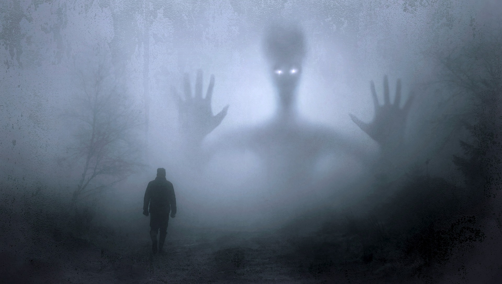
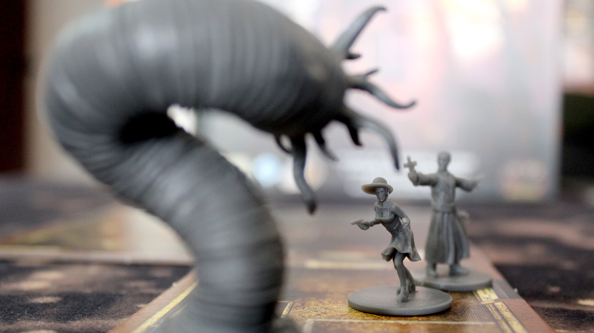
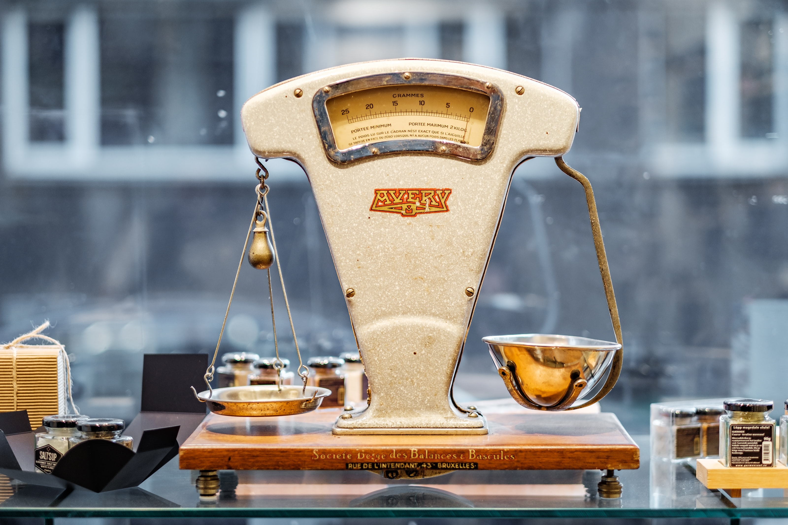

**That is why, in my opinion, if you need to maintain game-mechanical balance in a tabletop RPG, then you should not maintain it at all.**

<figure>
    
    <figcaption><i>If you cannot control chaos, try to comprehend it. The author accepts no responsibility for excessive contemplation of the abyss.</i></figcaption>
</figure>
 

*"This is not balanced and is broken." - players, at various times.*

I should note at once that this post deals mostly with D&D 5e. I will clearly mark examples taken from other systems.

The question of encounter balancing pains both beginning game masters and people who have moved to a new system. In D&D, the war-game heritage is still felt despite the system's evolution across five editions. Challenge Ratings (CR), character strength calculations, and the sheer pile of numbers frustrate me. Mostly because I value slightly different aspects of tabletop roleplaying. On top of that, I am deeply convinced that the concept of CR makes sense only as training wheels for learning to ride a bicycle. At some point, consciously or not, you learn to move forward without help.

However, let us take this in order.
<ol>
<li><a href="#challenge-rating-and-the-famous-heroes-of-eberron">Challenge Rating and the famous heroes of Eberron.</a></li>

<li><a href="#is-balance-about-realism">Is balance about realism?</a></li>

<li><a href="#is-balance-about-fairness">Is balance about fairness?</a></li>
</ol>

## Challenge Rating and the famous heroes of Eberron

**Low-CR monsters can kill a party, even when the outcome is unlikely.**

**High-CR monsters can die quickly, even when the outcome is unlikely.**

**CR's predictability and repeatability are surprisingly low.**

<figure>
    
    <figcaption><i>I calculated and weighed every factor in the encounter, but I have trouble with the calculation. Do you have a spare character sheet?</i></figcaption>
</figure>
 

I need to start from a little farther away so the examples have enough context. In one of my campaigns, an early conflict arose after the first story arc. It was an encyclopedic conflict of interests. Part of the group wanted more narrative. With shining eyes and in overlapping voices, they could roleplay conversations with NPCs or one another for an entire session. The other part wanted more combat scenes. Brutal fights built around tactical planning against an overwhelming enemy are their preferred style. Who was right in that conflict? Everyone, because everyone enjoys the game in their own way.

For a long time between story arcs, I tried to please both sides and keep the group together. The answer was obvious: I could not. That was the point at which the campaign split into two: one more narrative and one more combat-focused. Each had its own story branch, while the branches could still interact. That sounds amazing on paper and looks even better in a played campaign. At the same time, preparation time could triple in the best-case scenario. When you run a game under those conditions, you reach for every supporting resource available.

That is when I began abusing the encounter builder at [5e.tools](https://5e.tools/bestiary.html). It is now my favorite encounter-building tool. Besides being convenient, I love its "Absurd" difficulty level, a setting I have not found in similar tools.

At the time, this was the easiest way I knew to select monsters for the combat group. Give them a Deadly encounter and add tactics from [The Monsters Know What They're Doing](https://www.themonstersknow.com/), and you can guarantee the post-session feedback: "The battle could have been harder. We wiped them out."

For the narrative group, meanwhile, the challenges were investigations, finding clues, and visiting wealthy merchants. They enjoyed combat too, but mostly from a story perspective. Accordingly, the CR of those encounters was Easy or Medium.

During the week when I seriously began questioning whether CR was an adequate metric, both groups played. Both consisted of four 3rd-level characters.

The combat group used terrain and coordination to smash two Slaadi (CR 8 each) into pieces. The narrative group came within a hair of a total party kill while facing a Wraith (CR 3) with several CR 1/2 allies.

Carefully weighed and calculated combat scenes defeated me yet again.

And the worst part was that neither encounter was important to the plot.

As usual, the combat group triggered the unlikely scenario that I had buried in a footnote in my notes in case the stars aligned and the dice fell the right way. Spoiler: they keep falling that way.

The narrative group decided to return to the scene of the crime and investigate a building they had previously ignored, just as they ignored a long rest because more urgent matters were at hand.

Situations like these happened more often than I wanted to admit, and I started asking myself:

What did I take away from this experience?

1. Know your players.

2. Something needs to change in combat encounter design.

The first point is too broad to discuss here, while the second can be expressed through simple methods:

+ Monster stat blocks are not carved in stone. They can be adjusted on the fly: reduce hit points, remove an exhaustion attack, add an attack triggered by rage or divine intervention, and so on.

+ Opponents are not stupid and may have reinforcements. Whether those reinforcements arrive depends on how the battle unfolds.

+ Sometimes combat is simply a way to get to a non-player character. More often, however, it is a more meaningful activity: seize a castle, catch a kidnapper, or rescue hostages. It is more than a fight, and that is what matters to portray. That way, the story can continue regardless of the outcome.

+ Encounter design does not end when initiative is rolled. It is an ongoing process. [Matthew Colville](https://www.youtube.com/channel/UCkVdb9Yr8fc05_VbAVfskCA) has [an excellent video](https://youtu.be/_0WselJEy6U) about exactly this.

Okay, I thought, if the CR approach does not help, could the answer be found in other systems?

## Is balance about realism?

**In a system where characters are close to real people in strength and skill, they normally cannot overcome a substantial portion of the threats around them.**

**That is the main charm: the hero was not supposed to succeed, but did.**

**In that case, the balance of power is far from equal.**

<figure>
    
    <figcaption><i>Neither a cross nor a pistol impressed the unspeakably horrific creature from the depths of time and space. Make a sanity check.</i></figcaption>
</figure>
 

Call of Cthulhu may be my favorite system for this reason: there are things and phenomena that cannot be defeated, only delayed. You can kill goblins for a century, but you will never gain enough power to attack Azathoth. 

This is good for several reasons. First, the achievement threshold is lower. Investigators are ordinary people facing extraordinary forces. Pushing back the inevitable, even briefly, is already an accomplishment. Second, players do not feel omnipotent.

In D&D, with enough preparation, magic items, and determination, heroes can go and tear Orcus, Nyarlathotep, or the Warforged Colossus to pieces. That is wonderful, because that is how heroic fantasy works. This concept is entirely alien to Call of Cthulhu, where, until recently, the Great Old Ones had no stat blocks: if something has a stat block, you can kill it.

It is entirely realistic, and in this way, the balance shifts so far from equality that victory is achieved against the odds rather than because of them. That is what makes it valuable: it feels almost like real life, where one can accomplish more than ever expected despite difficulties. Here, the absence of balance as a concept adds color to the story players tell together around the table.

And yet, when we want realism to uncover a secret cult, we usually sit down at a table rather than carry a revolver around garages. So, along with a desire for "real" events, something else must be involved.

## Is balance about fairness?

**Attack when you have excessive force. Defend when your force is insufficient.**

**If the heroes' chance of victory is the same as their opponents', it becomes a confrontation between players and the game master.**

**When the desired outcome is to win, it harms everyone at the table.**

**Fairness has nothing to do with it.**

<figure>
    
    <figcaption><i>You have been weighed, you have been measured. Rocks fall, you die.</i></figcaption>
</figure>
 

Even if the game master sends a full party of evil character duplicates against the group, they will not be in equal circumstances.

The group usually has more people who act together and will think of things that never occur to the game master. At the same time, the game master objectively has more options: they control the entire game world, while every other player is limited to one or several heroes. Of course, some games let everyone control squads, armies, or kingdoms, but ultimately that is simply a scaled-up version. The game master always has a way to outplay the party. A famous rockfall that kills the group without any saving throws is a perfect example.

When trying to balance encounters, the game master looks for new ways to create a challenge for the sake of challenge rather than, for example, advancing the story. Worse, they may begin taking away items and abilities from the characters. Meanwhile, in righteous anger, the group looks for ways to bypass challenges or simply break the story.

This is the game master's confrontation with the other players. It is a cold war in which the conflict appears to remain entirely within the game. Whatever its cause, if the confrontation is not conscious and is not the goal of the game, destructive effects are inevitable. Stakes within the game rise, and everything except victory fades into the background. Everyone forgets that the game master is also a player (albeit with additional responsibilities) who <i>came to have a good time too.</i>

This and much more can be found in the subreddit [r/rpghorrorstories](https://www.reddit.com/r/rpghorrorstories/).

The main question is, why did the players gather?

There is no right answer unless everyone is having fun. One of my parties met regularly to talk with one another. The game was merely a fun addition.

In other parties, players repeatedly made absurdly powerful characters, and the goal was to break the story. It was a pure confrontation between the game master and the other players. But since everyone understood that this was the goal, there was no problem.

For me, I have concluded that what I value in tabletop roleplaying is collaborative storytelling. To tell those stories, the system is more of a set of tools and recommendations than a restriction or an obligation to follow rules rigidly. Bend the system, break the rules, create your own - as long as everyone is having fun, this is your shared game, and it is wonderful. For everything else, there are ordinary board games. Even in chess, however, the player who moves first has a certain advantage.

**That is why, in my opinion, if you need to maintain game-mechanical balance in a tabletop RPG, then you should not maintain it at all.**
