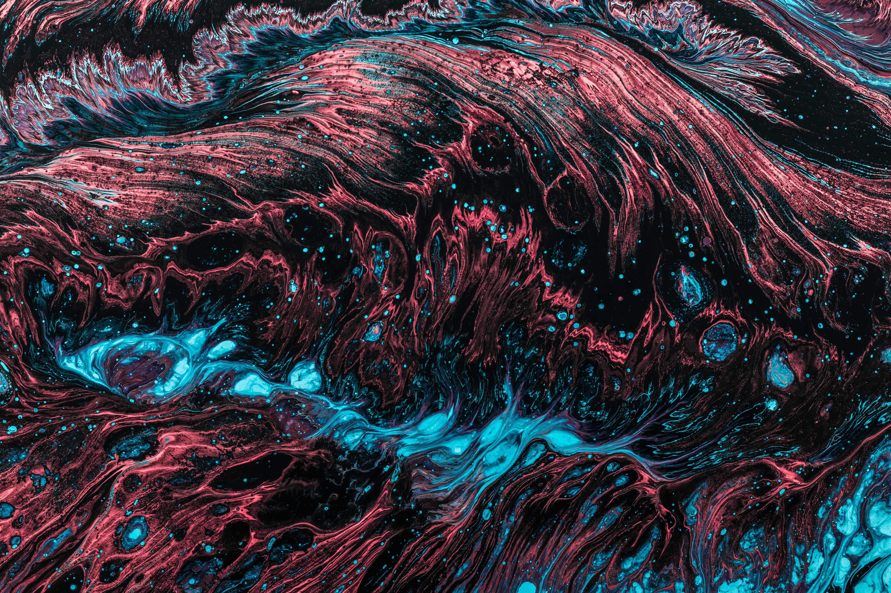
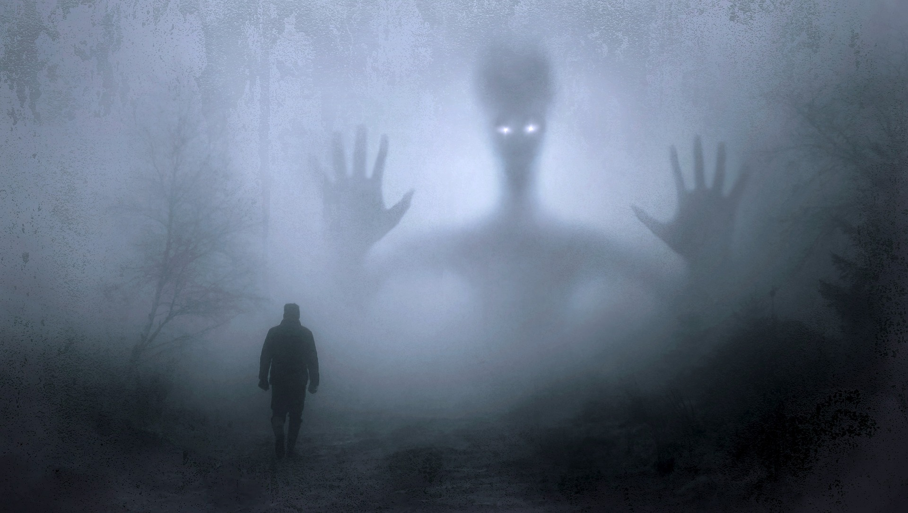
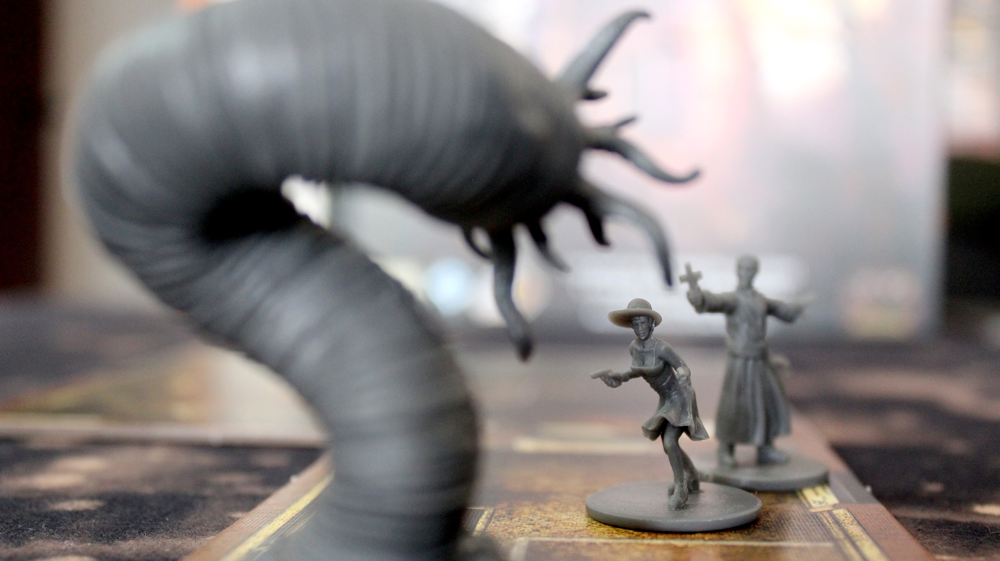
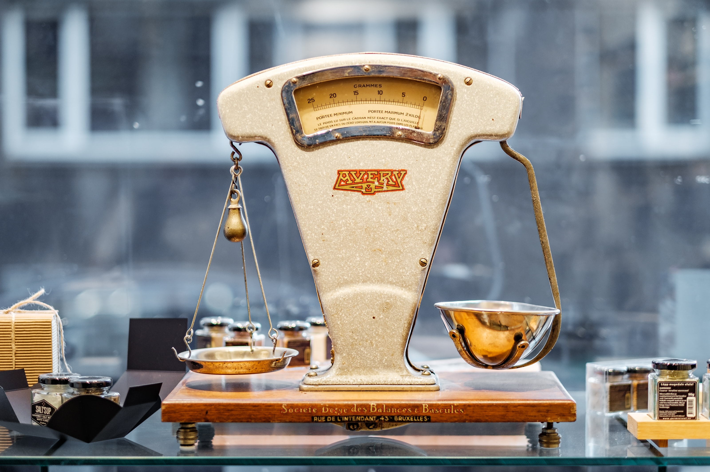

**Саме тому, на мою думку, якщо треба тримати ігромеханічний баланс в НРІ - то тримати його вже не треба.**

<figure>
    
    <figcaption><i>Якщо не можеш контролювати хаос, спробуй його осягнути. Автор не несе ніякої відповідальності за надмірне споглядання безодні.</i></figcaption>
</figure>

*«Це не баланс і зламано.» - гравці, в якийсь момент часу.*

Одразу зазначу, що в цьому дописі мова піде, здебільшого, про D&D 5e. Приклади з інших систем я буду явно позначати. 

Питання балансування зіткнень (енкаунтерів) болить як починаючим майстрам, так і тим, хто перейшов в нову систему. Що стосується D&D, то передісторія варгейму досі відчувається, попри еволюцію в п'ять редакцій. Показники Небезпеки (далі - ПН), розрахунок сили героїв та просто купа цифр викликають у мене фрустрацію. Здебільшого тому, що я ціную в НРІ злегка інші аспекти. Але на додачу до цього я глибоко переконаний, що концепція ПН має сенс виключно як допоміжні колеса для навчання їзді на велосипеді. В якийсь момент, свідомо чи ні, навчаєшся рухатися вперед без допомоги.

Втім, все по порядку. 
<ol>
<li><a href="#показник-небезпеки-і-славнозвісні-герої-еберрону">Показник Небезпеки і славнозвісні герої Еберрону.</a></li>

<li><a href="#баланс-це-про-реалізм">Баланс це про реалізм?</a></li>

<li><a href="#баланс-це-про-чесність">Баланс це про чесність?</a></li>

## Показник Небезпеки і славнозвісні герої Еберрону

**Монстри з низьким ПН можуть вбити групу, навіть коли це малоймовірно.**

**Монстри з високим ПН можуть швидко загинути, навіть коли це малоймовірно.**

**Прогнозованість і повторюваність використання ПН напрочуд низька.**

<figure>
    
    <figcaption><i>Я прорахував і зважив усі чинники зіткнення, та з рахуванням у мене проблеми. Маєш запасний лист персонажа?</i></figcaption>
</figure>

Тут треба зайти здалеку, щоб приклади були у зрозумілому контексті. В одній з моїх партій на ранньому етапі кампанії, після першої сюжетної арки, розгорівся конфлікт. Це був енциклопедичний конфлікт інтересів. Частина групи хотіла більше наративу. Вони з сяючими очима і на різні голоси могли цілу сесію відігравати діалоги, як з НПС так і один з одним. Інша ж частина групи бажала більше бойових сцен. Зубодробильні бої з продумуванням тактики проти переважаючих сил противника - це їх стиль. Хто з них був правий в цьому конфлікті? Всі, адже кожен отримує задоволення від гри по-своєму.

Тривалий час між сюжетними арками я думав, як догодити обом сторонам і зберегти групу. Відповідь була на поверхні: ніяк. Це і стало моментом, в який кампанія розділилась на дві. Більш наративна і більш бойова. Для обох була окрема сюжетна гілка, і вони мали можливість взаємодії одна з одною. Звучить просто дивовижно на папері, і ще краще виглядає на іграх. І в той же час, витрати на підготовку, в кращому випадку, потроюються. Коли починаєш водити в таких умовах, то хапаєш всі підручні допоміжні ресурси.

Так я почав зловживати побудовою зіткнень в [5e.tools](https://5e.tools/bestiary.html). Наразі це мій улюблений інструмент для побудови зіткнень. Окрім зручності, мені надзвичайно подобається рівень складності Absurd, якого я не зустрічав в інших подібних інструментах.

Тоді це був найпростіший відомий мені спосіб підібрати монстрів для Бойової Групи. Якщо дати їм Deadly бій, приправлений тактикою з книги [The Monsters Know What They're Doing](https://www.themonstersknow.com/), то відгук по сесії гарантовано буде: "Бойовка могла б бути складніше. Розкидали їх.". 

В той же час, для Наративної Групи випробуваннями були розслідування, пошук зачіпок та прийоми у високородних торговців. Бій вони також любили, та більше з сюжетної точки зору. Тому і ПН в цих зіткненнях був відповідний - Easy або Medium. 

В той тиждень, коли я серйозно засумнівався в адекватності метрики ПН, обидві групи мали гру. Обидві складалися з 4 героїв 3-х рівнів.

Бойова скористалась місцевістю і злагодженістю, та розтрощила на друзки двох Скаладарів (кожен ПН 8). Наративна була на волосину від ТПК від зустрічі з Вайтом (ПН 3) з кількома поплічниками ПН 1/2. 

Ретельно виважені і прораховані бойові сцени вкотре мене перемогли. 

І найнеприємніше те, що жодне з цих зіткнень не було ключовим для сюжету.

Бойова група, як завжди, запустила малоймовірний сценарій, який я мілким шрифтом вніс в свої нотатки на випадок, якщо зорі зійдуться і куби правильно впадуть. Спойлер: вони щоразу падають саме так. 

Наративна група взагалі вирішила повернутися на місце злочину, і дослідити будівлю, яку раніше проігнорували. Так само, як проігнорували довгий відпочинок через більш нагальні справи.

Подібні оказії траплялись частіше, ніж мені хотілося б визнати, і я задумався:

Що я виніс з цього досвіду? 

1. Знай своїх гравців. 

2. Треба щось міняти в дизайні бойових сцен.

Перше занадто обширне, щоб розглядати тут, тоді як друге виражається в простих методах:

+ Статблоки монстрів не висічені в граніті. Їх можна підкоригувати на ходу - знизити хітпоінти, прибрати атаку через виснаження, додати атаку від розгніваності або божественого втручання, тощо.

+ Противники не дурні, і мають підкріплення. Чи виходить це підкріплення? Залежить від успіхів на полі бою.

+ Інколи бій - це просто докопатися до неігрового персонажа. Та частіше це більш змістовна діяльність. Захопити замок? Наздогнати викрадача? Звільнити заручників? Це більше ніж просто бій, і ось що важливо обіграти. Так сюжет можна рухати далі, незалежно від результату.

+ Дизайн зіткнення не закінчується в момент, коли кинуто на ініціативу. Це тривалий процес. У [Метью Колвілла](https://www.youtube.com/channel/UCkVdb9Yr8fc05_VbAVfskCA) є [прекрасне відео](https://youtu.be/_0WselJEy6U) саме про це.

Окей, подумав я, якщо підхід з ПН не допомагає, то може є рішення в інших системах?

## Баланс це про реалізм?

**В системі, де персонаж близький до реальних людей за силою і вправністю, значну частину загроз він, за нормальних умов, подолати не спроможний.**

**В цьому і є головний шарм - герой не мав цього зробити, але зміг.**

**І баланс сил, в такому випадку, дуже далекий від рівноцінного.**

<figure>
    
    <figcaption><i>Ані хрест, ані пістолет не вразили невимовно жахливу істоту з глибин часу і простору. Кидайте на безумство.</i></figcaption>
</figure>

Мабуть, моя улюблена частина системи Call of Cthulhu: є речі та явища, які неможливо перебороти. Тільки відтермінувати. Рубай ґоблінів хоч століттями, ти не розкачаєшся достатньо, щоб замахнутися на Азатота. 

Це добре одразу з низки причин. По-перше, планка досягнення нижче. Сищики - звичайні люди, їм протистоять надзвичайні сили. Тобто, відкласти неминуче, хай ненадовго, це вже прекрасно. По-друге, у гравців відсутнє відчуття всемогутності. 

В D&D, маючи достатньо підготовки, магічних предметів та наполегливості, герої можуть піти і порубати на шмаття Оркуса, Нів-Мізета або Кованого Колосса. І це прекрасно, адже героїчне фентезі так і працює. Цей концепт зовсім чужий для Поклику Ктулху, де донедавна у Древніх Богів не було статблоків, адже якщо воно має статблок ти можеш його вбити.

Це цілком реалістично, і таким чином баланс зміщений настільки далеко від рівного, що перемога здобувається всупереч, а не завдяки. Тим вона і цінна, це відчувається майже як в реальному житті, де попри труднощі виходить досягти більше, аніж колись сподівався. Тут відсутність балансу, як явища, додає барв історії, яку гравці разом розказують за столом.

І все ж, бажаючи реалізму, щоб викрити таємну діяльність культу, ми частіше сідаємо за стіл, аніж ходимо з револьвером за гаражі. Тож окрім жаги до "реальних" подій має бути щось іще.

## Баланс це про чесність?

**Нападаєш, коли маєш надмірну силу. Захищаєшся, коли сила недостатня.**

**Якщо у героїв ймовірність перемоги така сама, як і у опонентів - це переходить в протистояння гравців та майстра.**

**Де бажаний результат - виграти, що шкодить всім, хто грає.**

**Чесність тут ні до чого.**

<figure>
    
    <figcaption><i>Ти був зважений, ти був виміряний. Каміння падають, ти помираєш.</i></figcaption>
</figure>

Навіть якщо майстер виставить проти групи злих двійників персонажів у повному складі, вони не будуть в рівних умовах. 

Група, зазвичай, має більше людей, які діючи разом, подумають про речі, які майстру на думку не спадають. Тоді як майстер об'єктивно має більше можливостей - він контролює увесь ігровий світ, тоді як кожен інший гравець обмежується одним або кількома героями. Звісно, є ігри де кожен контролює загони, армії, королівства, та в підсумку це просто масштабований варіант. У майстра завжди є спосіб переграти партію. Сумнозвісне каміння, що падає і вбиває групу без жодних рятівних кидків, прекрасний тому приклад. 

У спробах збалансувати зіткнення майстер шукатиме нових способів створити партії виклик, задля самого виклику, а не, приміром, для просування сюжету. Або, що ще гірше, почне забирати предмети і здібності у персонажів. Група, тим часом, у праведному гніві шукає способів обійти виклики, або просто зламати сюжет.

Це і є  протистояння майстра іншим гравцям. Холодна війна, де наче б то весь конфлікт в межах гри. З яких би причин це не відбувалось, коли протистояння не свідоме і не є ціллю гри, деструктивний вплив неминучий. Ставки всередині гри зростають, все, окрім виграшу, відкладається на другий план. Всі учасники забувають, що майстер теж гравець (хоча і з додатковими зобов'язаннями), і <i>теж прийшов добре провести час.</i> 

Про це, і багато іншого, сабреддіт  [r/rpghorrorstories](https://www.reddit.com/r/rpghorrorstories/).

Головне питання, навіщо гравці зібралися?

Правильної відповіді тут немає, допоки всім учасникам весело. Одна з моїх партій регулярно збиралась на ігри, щоб поспілкуватися один з одним. Гра була радше веселим доповненням. 

Неодноразово бувало, що інша партія робила жахливо потужних персонажів, і ціллю гри було зламати сюжет. Чисте протистояння майстра іншим гравцям. Та оскільки всі розуміли, що це і є мета, то і проблем не було.

Для себе я визначив, що ціную в НРІ колективні історії. Щоб їх розказати, система це радше набір інструментів та рекомендацій, аніж обмеження і жорстке слідування правилам. Згинай ігрові системи, ламай правила, придумуй власні - допоки всім весело, це ваша спільна гра, і вона чудова. Для всього іншого є звичайні настільні ігри. Втім, навіть в шахах певна перевага на боці того, хто ходить першим.

**Саме тому, на мою думку, якщо треба тримати ігромеханічний баланс в НРІ - то тримати його вже не треба.**